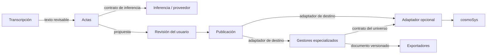

# Propuesta de arquitectura modular para revisión con Txinto

Fecha: 26/10/2026. Estado: propuesta, pendiente de acuerdo; no modifica despliegues.
Base revisada: commit 6bfbe7d. Autoría de la propuesta: Fran con asistencia de Codex.

## Decisión propuesta

Organizar el sistema por capacidades y propiedad de datos, con contratos explícitos.
cosmoSys no debe necesitar los gestores, los modelos IA ni los exportadores para
funcionar. Las aplicaciones especializadas consumen capacidades del universo y
mantienen sus propias reglas. Un plugin puede adaptar cosmoSys a esos contratos;
no es necesario instalar un plugin por cada aplicación consumidora.

La independencia no significa ausencia de dependencias: significa que son
declaradas, acotadas, versionadas y sustituibles donde exista una alternativa.
REST es un transporte; por sí solo no establece esos límites. Tampoco tener un
repositorio o proceso por componente demuestra modularidad.

## Evidencia del código actual

| Componente | Separación existente | Acoplamiento o límite encontrado |
|---|---|---|
| Gestores | Procesos y SQLite por modo; cliente HTTP de cosmoSys | Historias y académico comparten application.py y UI; reglas por modo; importación de bridge por sys.path y carpeta hermana |
| Documento académico local | Texto y revisiones propios; permite editar si falla la lectura del universo | Crear instancia necesita snapshot remoto; login sigue ligado a Redmine; no equivale a autonomía completa offline |
| Historias | Aplicación web con dirección propia | Conserva trabajos cuyo texto pertenece a ramas de cosmoSys; migración a instancias locales no generalizada |
| Plugin exchange | Snapshot/cambios/nodos, permisos y transacciones dentro de Redmine | Reúne intercambio y semántica; create_node contiene plantillas story/script/series/paper/tfg que pertenecen a consumidores |
| Inferencia | Proceso HTTP que delega en Ollama | Adaptador de proveedor concreto; liveness no garantiza disponibilidad del modelo |
| Actas | Consume RemoteInference por HTTP; sin credenciales Redmine | Reutiliza handler de inference_server; no cola persistente ni cancelación |
| Transcripción | Proceso REST, archivo de originales, motores intercambiables | Dependencias de ejecución y selección de dispositivo; no multiGPU validado |
| Publicación | Interfaz de adaptador y revisión previa vinculada al contenido | Adaptador disponible RedmineWiki; no escritura estructurada universal; revisiones pendientes en memoria |
| Exportación | Transformación determinista y manifiesto reversible | Biblioteca cargada dentro del gestor; no servicio REST autónomo de exportación |

Evidencias: clients/Gestores/{application.py,store.py,cosmosys_client.py},
clients/Intercambio-textos/{bridge.py,rest_adapter.py}, services/{minutes_server.py,
publication.py,README.md,openapi.json}, docker/local-plugins/cosmosys_exchange_api/
{config/routes.rb,app/controllers/cosmosys_exchange_controller.rb}.

La revisión es estática sobre este fork; no demuestra equivalencia con el diseño
interno de CGRol ni inspecciona la última versión upstream. Algunos README conservan
estados históricos contradictorios: consolidarlos forma parte del trabajo pendiente.

## Límites objetivo

| Capacidad | Datos y reglas que posee | Dependencias necesarias / opcionales |
|---|---|---|
| Universo cosmoSys | Conceptos, fuentes, relaciones, permisos, revisiones y restricciones del universo | Ningún gestor ni IA necesarios |
| Adaptador cosmoSys | Traducción de contrato a operaciones nativas; autorización y transacción | cosmoSys; reutilizar API nativa donde sea suficiente |
| Gestor de historias | Obras, escenas, puntos de vista, orden y variantes de una historia | Contrato del universo para enlazar/sincronizar; IA y exportadores opcionales |
| Gestor académico | Estructura, argumentos, citas y revisión de un trabajo | Contrato del universo para fuentes; perfil APA opcional |
| CGRol | Sus reglas y estados propios de rol | Acordar con su mantenedor integración real; no rediseñarlo por analogía |
| Transcripción | Original, integridad, intentos y segmentos | Un motor ASR; GPU opcional, CPU configurable |
| Inferencia | Acceso a proveedores, capacidades y límites de ejecución | Un proveedor configurado; hardware ajeno al consumidor |
| Actas | Conversión de transcripción a propuesta de acta | Contrato de inferencia para generar; sin acceso directo a cosmoSys |
| Publicación | Propuesta revisada, destino, trazabilidad y resultado | Adaptador específico por destino; no impone su esquema de negocio |
| Exportación | Documento derivado y correspondencia con fragmentos/revisiones | Contrato documental; no consulta directamente bases de datos ajenas |

Las flechas representan consumo o flujo de datos, no despliegue conjunto obligatorio.
El propietario de cada dato valida toda escritura. Los clientes pueden anticipar
errores, pero no sustituyen esa validación. Las reglas particulares de una obra no
deben convertirse en restricciones universales del canon.

## Contratos y dependencias

1. Separar contrato de universo y contrato de documento. Referencias propuestas:
   proveedor, universo/proyecto, identificador estable y revisión de origen.
   Documentar explícitamente referencias vivas frente a snapshots; no sincronizar
   variantes de una obra al canon automáticamente. La política de versiones del
   universo queda pendiente, no se afirma implementada.
2. Mantener exchange/v1 compatible. Describir esquema, operaciones, permisos,
   límites, errores y revisiones esperadas en OpenAPI/JSON Schema. El OpenAPI
   existente de servicios IA no cubre por sí solo el contrato completo del universo.
3. Escrituras con versión esperada y clave idempotente; misma clave con otro
   contenido produce conflicto. Definir alcance y persistencia de deduplicación.
   Cada servicio realiza su transacción; una operación entre servicios necesita
   estado recuperable y reconciliación, no promesas de transacción global.
4. Identidad separada de la cuenta técnica. El dueño del dato decide permisos;
   registrar actor autenticado y servicio ejecutor. No confiar en un user_id enviado
   libremente. LDAP/SSO y delegación requieren diseño posterior; no están resueltos.
5. IA expone capacidades, disponibilidad y límites; el cliente no conoce CUDA,
   NVLink ni rutas de modelos. El fallback debe ser visible y configurable, sin
   envío automático a nube. Sustituir motor no promete idéntico resultado.
6. Exportación e importación no requieren IA. Mantener identidad, orden y revisión;
   probar determinismo e ida/vuelta. Perfiles editoriales son extensiones del
   exportador, no plugins de Redmine.
7. Definir timeouts, errores distinguibles, correlation ID y pruebas de contrato.
   Trabajos largos de audio podrán usar jobs persistentes con consulta/cancelación;
   no introducir broker o ESB antes de justificarlo con necesidades concretas.

## Empaquetado y despliegue

Conservar inicialmente el monorepo para no perder historia ni fragmentar el trabajo.
Crear paquetes instalables con dependencias declaradas: contratos, SDK/adaptadores,
motor documental, aplicaciones y servicios. Eliminar sys.path entre carpetas de
aplicaciones. Una biblioteca compartida debe ser pequeña y versionada; evitar
una biblioteca central que reúna todas las reglas de negocio.

Cada aplicación tendrá instalación, configuración, pruebas y ciclo de publicación
identificables. Perfiles de despliegue propuestos: núcleo; gestor elegido; IA
opcional. Exportación puede seguir como biblioteca dentro del gestor hasta que
dependencias o carga justifiquen proceso propio. Separar repositorios después,
si los responsables y ciclos de versiones lo requieren; no es un prerrequisito.

## Plan incremental y criterios de aceptación

1. **Acordar fronteras con Txinto.** Confirmar API nativa reutilizable y funciones
   mínimas del adaptador. Entrega: matriz de propiedad y contrato del universo.
2. **Extraer dependencias de código.** Paquetizar bridge, separar lógica de gestor
   y adaptadores, extraer infraestructura HTTP común de los servicios. Aceptación:
   instalar/probar cada aplicación desde un entorno limpio sin carpetas hermanas.
3. **Adelgazar plugin.** Sacar plantillas de historias/TFG al consumidor, manteniendo
   compatibilidad temporal y operaciones genéricas transaccionales/autorizadas.
   Revisar si la semántica es responsabilidad nativa antes de crear más plugins.
4. **Probar independencia efectiva.** cosmoSys arranca sin extras; exportación sin
   IA; actas con proveedor simulado; gestores con adaptador simulado; cada uno sin
   permisos de lectura a bases ajenas. Interrumpir dependencias y verificar error
   claro, conservación local y recuperación sin duplicados. Precisar qué operaciones
   quedan bloqueadas por autenticación o sincronización.
5. **Contribución pequeña upstream.** Presentar únicamente contrato/adaptador acordado
   y pruebas, con compatibilidad y migración documentadas. Gestores y servicios
   opcionales permanecen en el fork. No ampliar ni fusionar la PR actual sin revisión.

## Preguntas concretas para la revisión conjunta

- ¿Qué operaciones ya ofrece cosmoSys y qué extensión mínima falta realmente?
- ¿Qué invariantes debe validar el núcleo y cuáles son propias de cada instancia?
- ¿Qué versiones de cosmoSys/CGRol se compromete a soportar el adaptador?
- ¿Aceptamos monorepo con paquetes opcionales o existen responsables que necesitan
  repositorios y ciclos de versiones separados desde ahora?

El objetivo compartido es reducir la superficie de mantenimiento de cosmoSys y
hacer verificable la independencia de las aplicaciones. Esta propuesta no solicita
incorporar funciones académicas, IA o producción narrativa al núcleo.
