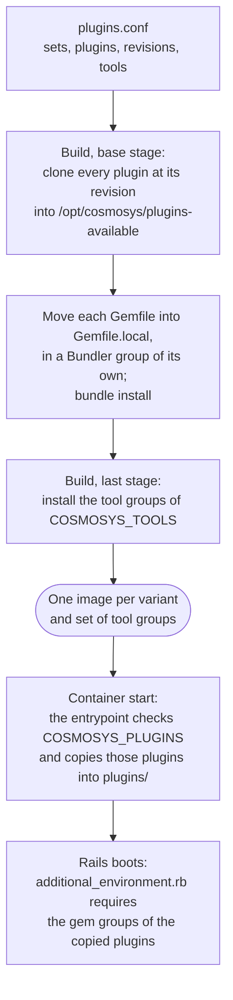

# How optional plugins work

Optional plugins are grouped in sets, such as `kroki` or `tags`, that an
instance turns on in its environment file (`COSMOSYS_PLUGINS`). This document is
for whoever maintains the deployment: how a set goes from the catalog into the
image and from the image into a running instance, how to add a set, how to move
its pins, and what the errors mean.

The `cad` set groups the cosmoBots CAD viewer fork and its cosmoSys integration.
It needs the `libredwg` prebuilt tool group, but no service. Browser assets are committed in their
source repositories; the base Redmine image supplies ImageMagick. Both the
disposable validator and updater run `bootstrap/verify_cad.rb`, checking
real DWG conversion, asset delivery, macro registration, PNG validation and
independent named views in temporary storage, without writing project data.
The [retained builder](../tools/libredwg/README.md) is separate from the image
build; only CAD images receive its checked binary, license and corresponding
sources. Static report figures require an explicitly saved view.
`validate-update.sh` also activates and deactivates the CAD pair through the
canonical updater and verifies that existing test data survives both switches.

How to choose the sets of an instance is in the README.

## The path of a plugin



### The catalog

`plugins.conf` is the only place where an optional plugin is declared. It is
read as `KEY=VALUE` lines, never executed, by the scripts on the host and by the
image, through the same functions (`scripts/catalog-lib.sh`). Its header lists
every key. A set names its plugins, and optionally:

- the tool groups it needs in the image (`OPTION_<set>_TOOLS`);
- an overlay with the services it adds (`OPTION_<set>_COMPOSE`);
- the settings that pin the images of those services (`OPTION_<set>_PINS`).

A plugin comes from a public repository at a full commit
(`PLUGIN_<id>_SOURCE` and `PLUGIN_<id>_REVISION`, with `PLUGIN_<id>_SUBDIR`
when the plugin is a directory of the repository), or from a directory of this
repository (`PLUGIN_<id>_LOCAL`). Two sets may share a plugin: `latex` and
`notebooks` both carry `redmine_cbots_latex`.

### The image

`docker/install-optional-plugins.sh` runs in the base stage. It clones every
plugin of the catalog, checks that the commit is the declared one, and leaves
it in `/opt/cosmosys/plugins-available/<id>`, where Redmine never looks. It
moves the `Gemfile` or `PluginGemfile` of each plugin to
`/opt/cosmosys/gemfiles` and adds it to `Gemfile.local` inside
`group :cosmosys_<id>`. `bundle install` then installs the gems of every
plugin, so the Gemfile is the same whatever an instance turns on and no
container installs gems when it starts.

The last stage builds on the chosen variant and installs only the tool groups
of `COSMOSYS_TOOLS` (`docker/install-tools.sh`). Debian packages
(`TOOLS_<group>_APT`) come from apt. Python packages (`TOOLS_<group>_PYTHON`)
go into one virtual environment, `/opt/cosmosys-python`, from
`docker/python/<group>.txt`, which pins the whole dependency closure of the
group with the hashes of every file. pip resolves nothing at build time and
`pip check` verifies the result. The image tells the plugins where those tools
are:

| Variable | Read by | Value |
| --- | --- | --- |
| `LATEX_PYTHON_BIN` | `redmine_cbots_latex`, to render formulas as images | `/opt/cosmosys-python/bin/python` |
| `JUPYTER_BIN` | `redmine_notebook_preview`, which also takes the `python` next to it for the formulas of a notebook | `/opt/cosmosys-python/bin/jupyter` |
| `NOTEBOOK_CACHE_DIR` | `redmine_notebook_preview` | `/usr/src/redmine/tmp/notebook_cache` |

Prebuilt tools use `TOOLS_<group>_BUNDLE`, naming a directory under
`docker/tool-bundles/`. The final stage bind-mounts these directories from the
build context and runs only the selected installers. Unselected binaries and
sources do not enter any image layer. Each bundle must validate its hashes and
architecture and ship its license, build provenance and corresponding source
where required; compilation is a separate maintainer operation.

These are the defaults of the plugin settings. A value saved earlier in the
plugin settings page wins over them; the updater checks that LaTeX and the
notebook viewer find their tools and says which value to set when they do not.

Everything above the last stage is shared by all the instances of a variant.
The image name (`scripts/image-tag.sh`) is derived from the files that end up
in the image and the revisions it is built from, with the tool groups as a
suffix: `cosmobots/cosmosys-req:<cosmoSys>-<Requirements>-<hash>-redmine-7.0.1-mathtext.nbconvert`.

### The start of a container

The image runs `docker/cosmosys-entrypoint.sh` before the entrypoint of the
official Redmine image, in the three services that use it (`migrate`,
`bootstrap` and `redmine`). It:

1. checks `COSMOSYS_PLUGINS` against the catalog inside the image;
2. checks that the image has the tool groups those sets need;
3. copies the plugins of the sets into `plugins/`;
4. writes their names to `/opt/cosmosys-deploy/active-plugins`;
5. hands over to the official entrypoint.

Plugins are copied, not linked: they load their own files through `__dir__`,
which resolves links, so a linked plugin was loaded twice. Each copy carries a
marker file, so a restarted container keeps its copies and the entrypoint
refuses to overwrite anything in `plugins/` that it did not put there.

`config/additional_environment.rb` reads `active-plugins` and requires the gem
groups of those plugins only. Processes started with `docker exec` do not go
through the entrypoint, but read the same file.

### The host

`scripts/deployment-lib.sh` reads `COSMOSYS_PLUGINS` and `COSMOSYS_TOOLS` from
the instance file, adds the overlay of each set with services, and refuses to
build or start anything when `COSMOSYS_TOOLS` is not exactly the tools of the
sets. `scripts/provision-instance.sh --plugins` writes both settings and the
image name of a new instance. `scripts/update-instance.sh --plugins` changes the
sets of an existing one as an update: backup, rebuild, migrations, checks, and
a rollback to the previous image and sets if anything fails
(`docs/instance-updates.md`).

## Adding a set

1. Declare the set in `plugins.conf`: add it to `COSMOSYS_OPTIONS` and give it
   its plugins, tools, overlay and pins. Declare each new plugin with its
   source and full commit, or as a local directory copied by the Dockerfile to
   `/opt/cosmosys/plugins-available/<id>`.
2. If the set needs new tools, add a group to `COSMOSYS_TOOL_GROUPS` with its
   Debian or Python packages (or a checked prebuilt bundle), and run
   `scripts/update-pins.sh --python` to pin the Python ones.
3. If the set adds services, put only those services in its overlay, and pin
   their images in `.env.example` and in the defaults of the overlay.
4. Add checks of what the set does to `scripts/validate-deployment.sh` and
   `scripts/update-instance.sh`. The generic checks already cover the rest:
   registered plugins, dormant plugins and gems, Gemfile, assets, migrations
   and absent tools.
5. Run `scripts/update-pins.sh` to rewrite the image names and the table of the
   README, then `scripts/validate-deployment.sh all`, which validates every set
   alone on the base variant and all of them together on Requirements, and
   `scripts/validate-update.sh`.

A plugin fits this mechanism when it works from a copy in `plugins/` and its
Gemfile has no relative references (a `gemspec` line, for example), because the
Gemfile is moved. A plugin that needs another one (`requires_redmine_plugin` or
`Redmine::Plugin.installed?` in its `init.rb`) goes in a set that carries both.

## Moving pins

`scripts/update-pins.sh` moves every pin of the deployment: cosmoSys, cosmoSys
Requirements, rspreadsheet, the optional plugins and the Python tools. It takes
a tag, a branch or a commit, pins the full commit, refuses to move backwards
without `--allow-backwards`, and checks that cosmoSys Requirements and the
optional plugins accept the pinned cosmoSys. It rewrites `.env.example`, the
defaults of `compose.yml` and `compose.requirements.yml`, `plugins.conf`,
`docker/python/` and the pins table of the README, and ends with
`scripts/check-config.sh`. It commits nothing.

```sh
./scripts/update-pins.sh --plugin redmine_notebook_preview=<tag-or-commit>
./scripts/update-pins.sh --cosmosys 0.1.7 --cosmosys-req 0.3.2 --summary pins.md
./scripts/update-pins.sh --latest-tags
./scripts/update-pins.sh --python
```

`--summary` writes the old and new commits, a comparison link and the commits
in between, for the description of a pull request. `--python` resolves the
Python packages of the tool groups again, to their latest versions, inside the
Redmine image (it needs Docker); one resolution covers every group, so groups
installed together agree. Validate as for a new set before committing new pins.

## Turning a set off

Turning a set off removes its plugins from `plugins/` and its services from
the instance, and nothing else. Tables, settings and macros stay: text written
with a macro of the set stays as text, and tags stay in their tables, unseen,
until the set is turned on again. PORIS projects keep the `poris` profile,
which nothing registers once the set is off: they can be read and their items
edited, but their settings cannot be saved and no item can be added to them.
ADRs stay as issues of the `csAdr` tracker: while `adr` is off, cosmoSys shows
them in the tree and the report like any other item, `ADR#N` stays as text and
nothing locks a decided ADR. An issue added to that tracker meanwhile has no
ADR number and cannot be saved once the set is on again; delete it and create
it again as an ADR.
The updater refuses to turn off a plugin with database migrations applied
unless `--allow-plugin-removal` is passed, and never runs the migrations of a
plugin backwards.

## Errors

| Message | Meaning |
| --- | --- |
| `COSMOSYS_PLUGINS=... names a set this image does not offer` | A misspelt set, or an image older than the catalog of the checkout. The container stops (exit 64). |
| `the plugins in COSMOSYS_PLUGINS need the tool group ...` | The image was built without the tools of a set. Change sets with `update-instance.sh --plugins`, which rebuilds the image. |
| `COSMOSYS_TOOLS=... does not match the tools of COSMOSYS_PLUGINS` | The instance file names other tools than its sets need; the scripts stop before building. |
| `... already exists and is not an optional plugin of this image` | Something in `plugins/` has the name of an optional plugin. |
| `..._ENABLED=true belongs to the previous way of enabling optional plugins` | An instance file from before the catalog; replace the switch with `COSMOSYS_PLUGINS` and `COSMOSYS_TOOLS`. |
| `Refusing to turn off plugins with database migrations applied` | See the section above. |
